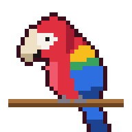
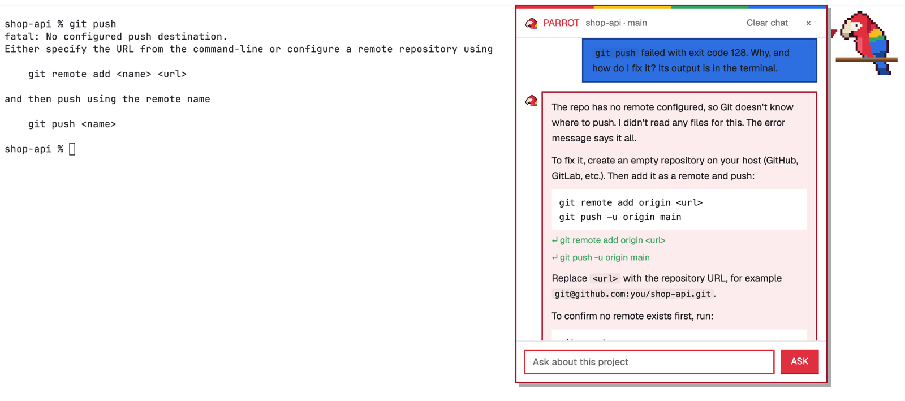
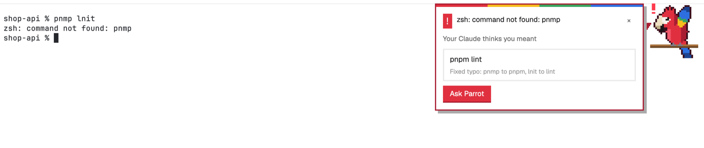
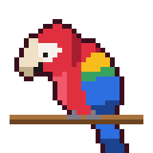
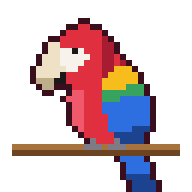
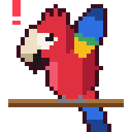
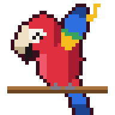
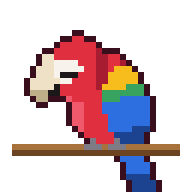

<p align="center">
  
</p>

<h1 align="center">Parrot</h1>

<p align="center">
  A pixel parrot for the <a href="https://herdr.dev">Herdr app</a> that watches your shell,<br>
  catches your typos and answers questions about your project, with your own Claude.
</p>

<picture>
  <source media="(prefers-color-scheme: dark)" srcset="docs/screenshots/chat-dark.png">
  
</picture>

Click the parrot to ask about the project in your terminal, or click **Ask Parrot** when a command fails. Your Claude reads the files it needs and answers beside the parrot. A click on a green **↵** link puts that command on your prompt, ready for Enter.

<picture>
  <source media="(prefers-color-scheme: dark)" srcset="docs/screenshots/typo-dark.png">
  
</picture>

Mistype a command and the parrot startles. Your Claude guesses what you meant, written out in full and never as an alias. **↵ Put on prompt** under the guess puts it on your prompt, as in the chat.

## Moods

|  |  |  |  |  |  |
| :-: | :-: | :-: | :-: | :-: | :-: |
| calm | watching | thinking | startled | dancing | asleep |

It sways while all is calm and tilts its head while a command runs. It thinks while Claude works, startles when a command fails and dances when the next one works. After ten quiet minutes it falls asleep.

## Install

You need the Herdr app, zsh, `jq` and [Claude Code](https://claude.com/claude-code), logged in. Clone this repo to a folder that stays, then run this with the Herdr app open:

```sh
./install.sh
source ~/.zshrc   # only in terminals that were already open
```

The installer links the mod, adds a **Parrot** button to the tab bar, binds the keys and adds one line to `~/.zshrc` for the shell hook. It backs up every file it changes first. Run it again after a `git pull`.

The first time you turn the parrot on, it says hello. A terminal that has not loaded the hook gets a note with **Load it here**.

## Use

- **Parrot** in the tab bar, or `⌥⌘P`: turn it on or off. It needs a terminal in the tab and sits in the top right corner.
- A click on the parrot, or `⌥⇧⌘P`: chat about the terminal's project. There is one conversation per git project.
- **↵** under a command: put it on your prompt, not yet run. A red link marks a command that deletes, overwrites, pushes or stops something.
- **▶ Run** under a command, or **▶ Run all** under several: run it in the terminal now. A red one waits three seconds, and a click or Esc stops it.
- **Clear chat**, or `/clear`: start the project's conversation over.

## What goes to Claude

Everything runs on your own Claude subscription through `claude -p`. Claude can only read: the project's files, and a fixed list of checks that only read, such as `git status`, `git remote -v` and `docker compose ps`. Claude Code refuses any other command. It changes nothing and uses no MCP servers, hooks or plugins.

- **A question** takes along the terminal's folder, its branch and its last 60 lines. Claude picks what to read and check itself, and each answer says **✓ Checked** with what it looked at, or **~ Hunch**.
- **A typo** is the only thing sent without a click. Haiku gets the line, its output, the project's scripts and your recent commands, and suggests a fix.

Keys, tokens and passwords are masked before anything is sent. Your `CLAUDE.md` files and auto-memory load as they do in Claude Code.

## Uninstall

```sh
./uninstall.sh
```

It undoes the installer: parrot's chats leave the app, the button leaves your layouts, its keys are freed, the mod is unlinked, the hook's line leaves `~/.zshrc` and `~/.parrot` goes. It backs up every file it changes first.

## Development

```sh
bun test                      # sprite, moods, hook, suggestions, chat, notes, layout and uninstall
bun run frames                # redraw the frames after changing scripts/sprite.js
herdr-app check mods/parrot   # load the mod once
```

The app does not see edits behind the installed link, so run `./install.sh` again after one. Every change is listed in the [changelog](CHANGELOG.md).

## License

[MIT](LICENSE)
